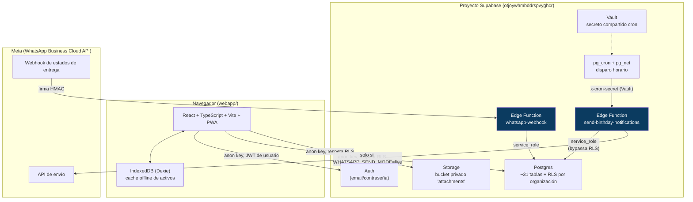
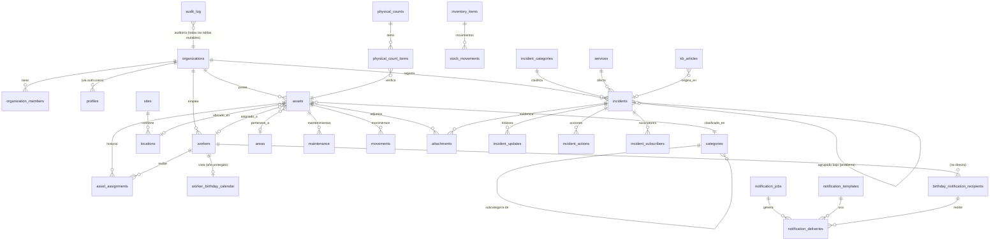

# Arquitectura — UNOP TI Hub

## Vista general

**Principio de seguridad central**: el cliente (navegador) solo tiene la
`anon key` y siempre pasa por RLS. La `service_role key` (que ignora RLS)
solo existe dentro de las Edge Functions, inyectada automáticamente por
Supabase como variable de entorno — nunca en código de cliente ni en
variables `VITE_*` (esas quedan embebidas en el bundle público).

## Módulos y rutas

| Módulo | Ruta base | Páginas |
|---|---|---|
| Tablero | `/` | Dashboard con conteos por módulo |
| Inventario | `/inventario`, `/catalogos` | Activos, detalle, mantenimientos, consumibles, conteo físico QR, reportes, catálogos |
| Trabajadores | `/trabajadores` | Directorio, cumpleaños, notificaciones WhatsApp |
| Incidentes | `/incidentes` | Listado, detalle/bitácora, base de conocimiento, panel de estado, reportes |

## Modelo de datos (ERD por módulo)

*(Diagrama simplificado — el detalle exacto de columnas está en cada
archivo de `supabase/migrations/`.)*

## Decisiones técnicas clave

- **Frontend sin framework de estado global**: React + Context API
  (`SessionContext`) alcanza para el tamaño de la app; se evitó Redux/Zustand
  para no añadir dependencias sin necesidad real.
- **Offline solo donde importa**: `assets` conserva caché Dexie + cola
  `outbox` (heredado de la app legacy, ver `webapp/src/data/db.ts`). Los
  módulos agregados en Fases 2-4 (catálogos, trabajadores, mantenimiento,
  incidentes, notificaciones) son online-first — decisión consciente
  documentada en `webapp/README.md`, revisable si se necesita offline ahí
  también.
- **IndexedDB compartida con la app legacy**: mismo `DB_NAME`, subiendo de
  v1 a v2, para no perder datos ya guardados en el navegador del usuario.
- **`write-excel-file` en vez de `xlsx`**: la librería `xlsx` (SheetJS)
  tiene 2 CVEs altos sin parche en su código de *parseo*; como el sistema
  solo **genera** Excel (nunca lee archivos subidos), se usó una librería
  que no incluye ese código en absoluto.
- **Columnas legacy conservadas como snapshot**: al ampliar `assets` con
  FKs a catálogos reales (Fase 2), las columnas de texto originales
  (`category`, `location`, `area`, `responsible`) no se borraron — quedan
  como historial y respaldo de lo que había antes de la migración.
- **RLS en vez de filtros de aplicación**: toda restricción de acceso
  (organización, rol, visibilidad interno/público, año de nacimiento) se
  implementa como policy de Postgres, no como `if` en el frontend — así un
  bug de UI no puede filtrar datos de otra organización.
- **Folios e idempotencia resueltos en la base de datos, no en la app**:
  el generador de folios (`private.next_incident_folio`) y las claves de
  idempotencia de notificaciones usan constraints únicos, no lógica de
  aplicación — sobreviven a reintentos, dobles clics y al cron disparando
  dos veces.

## Multi-trabajo y blueprints de oficio (migraciones 0030-0032)

UNOP TI Hub pasó de ser una app de un solo tenant (UNOP) a una herramienta
personal de un ingeniero que se mueve entre trabajos/clientes distintos,
manteniendo intactos los tres módulos (inventario, trabajadores, incidentes)
en vez de reducir el alcance:

- **Multi-organización real en el frontend**: `organization_members` ya
  soportaba varias filas por usuario (el esquema nunca lo impidió); lo que
  faltaba era que `SessionContext` dejara de asumir una sola membresía
  (`.maybeSingle()`). Ahora carga todas las membresías del usuario, mantiene
  un `activeOrgId` persistido en `localStorage`, y expone `memberships` +
  `switchOrganization()`. El selector vive en `ui/Layout.tsx`
  (`OrgSwitcher`).
- **Crear un trabajo nuevo**: no hay policy de `INSERT` directa sobre
  `organizations`/`organization_members` (evitaría que un usuario se
  auto-agregue a una organización ajena). En su lugar, `create_organization(p_name)`
  es una función `security definer` que inserta la organización y agrega al
  llamante como `owner` en una sola transacción. Ruta `/trabajos/nuevo`
  (`NewOrganizationPage`), accesible con sesión pero sin membresía
  (`ProtectedRoute requireMembership={false}`).
- **Campos personalizados** (`custom_field_definitions` / `custom_field_values`):
  cada organización define sus propios campos (texto, número, fecha,
  booleano, lista) para activos, trabajadores o incidentes, sin tocar
  código. Se administran en `/catalogos` (pestaña "Campos personalizados")
  y se editan con el componente genérico `ui/CustomFieldsPanel.tsx`, cableado
  hoy en el detalle de activos e incidentes.
- **Blueprints de oficio** (`trade_blueprints` + `apply_blueprint_to_organization`):
  paquetes reutilizables y versionados (JSON) que agrupan categorías/subcategorías,
  campos personalizados y categorías de incidente para un rubro técnico. Al
  crear un trabajo, el ingeniero elige un blueprint de sistema (`is_system = true`,
  visible para cualquier usuario) o uno personal propio, y
  `apply_blueprint_to_organization` los aplica de forma idempotente. Se
  sembraron dos blueprints de sistema: **"Generico"** (mínimo, cualquier
  rubro) e **"IT / Oficina"**, este último reconstruido automáticamente a
  partir de la configuración real de UNOP (no es un rubro inventado sin
  validar). Cada aplicación queda registrada en
  `organization_blueprint_applications` para trazabilidad.
- **Pendiente explícito**: cablear `CustomFieldsPanel` también en el modal
  de trabajadores (`WorkerFormModal`, solo tiene sentido en modo edición,
  cuando el trabajador ya tiene `id`); UI para exportar/importar blueprints
  personales como JSON; UI para que un `owner` cree blueprints personales
  nuevos desde una organización ya configurada (hoy solo existen los dos
  blueprints de sistema sembrados por migración).
